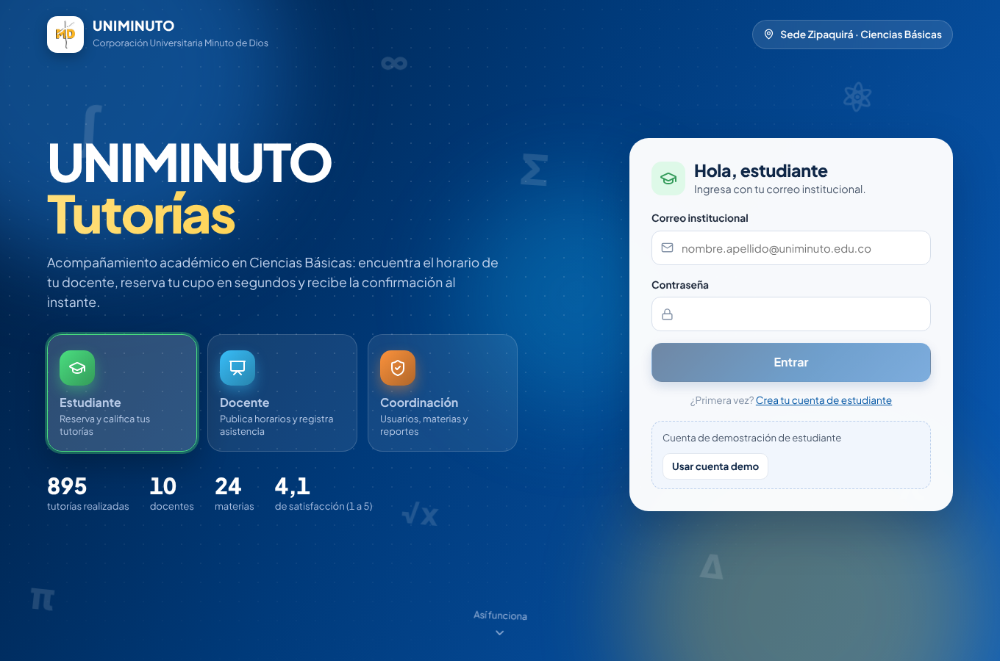
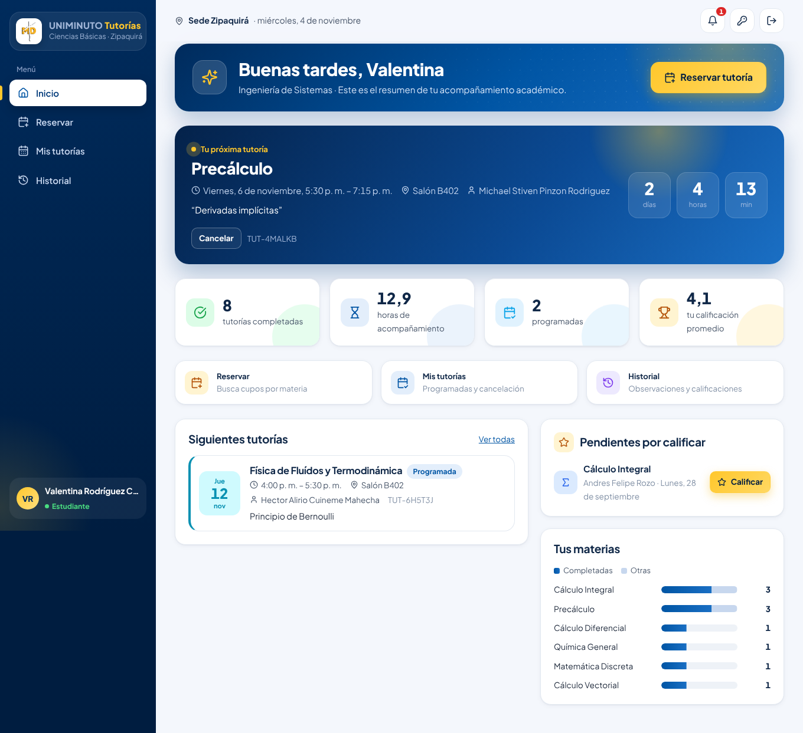
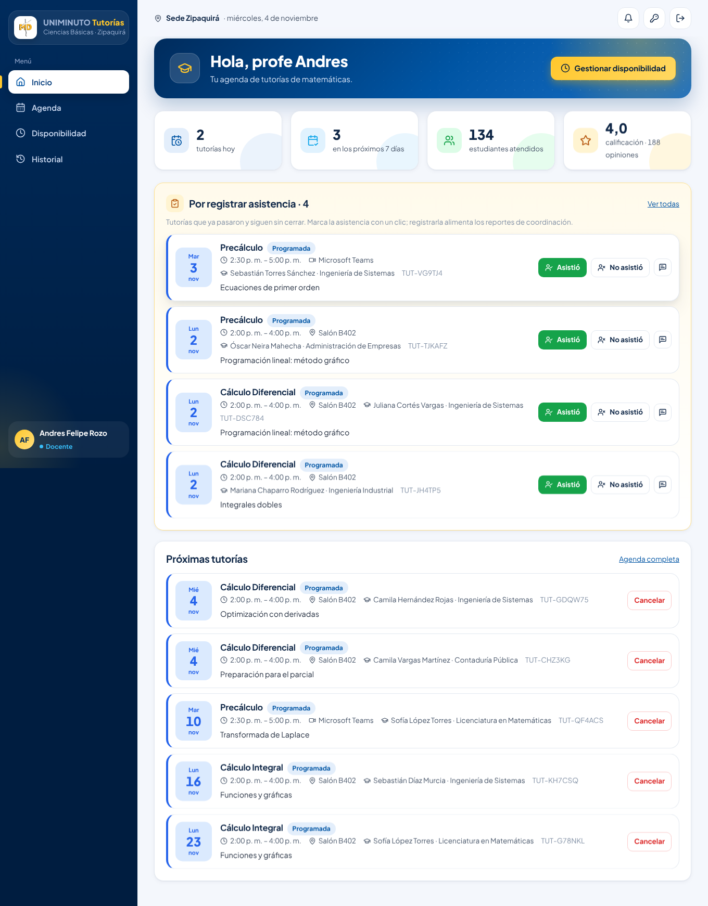
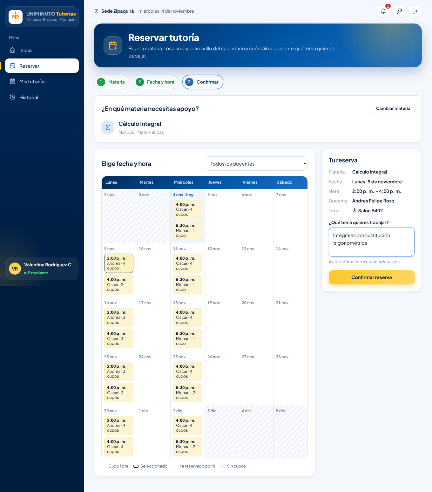
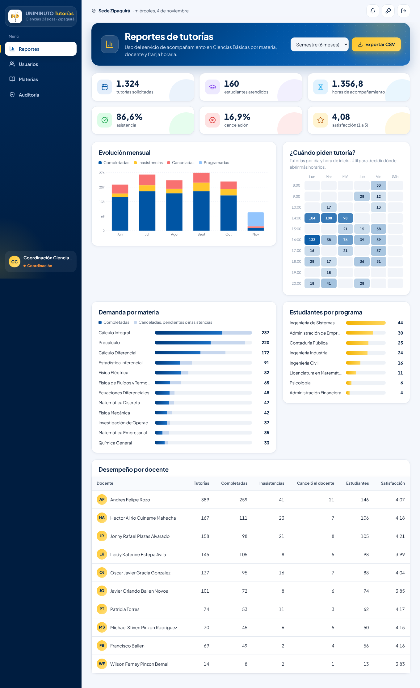

<div align="center">

# Sistema de gestión de tutorías para el área de ciencias básicas en la universidad UNIMINUTO sede Zipaquirá

**Simón Pinzón Algarra**<br>
**Juan David Jiménez Jiménez**<br>
**Juan David Vanegas Méndez**<br>
**Miguel Ángel Blanco Martínez**

Corporación Universitaria Minuto de Dios<br>
Arquitectura de software<br>
Docente: Edwin Arias Cruz

20 de noviembre de 2026

</div>

---

Plataforma para que los estudiantes reserven tutorías de cálculo, física, química y estadística, los docentes publiquen sus horarios y registren la asistencia, y la coordinación académica mida el impacto del acompañamiento.

Es la modernización del proyecto de Ingeniería de Software: el sistema PHP/XAMPP original (en [`legacy/`](legacy/)) se reconstruyó como **monolito modular con arquitectura hexagonal**, **API REST**, **SPA en React**, **Docker** y **CI/CD**, siguiendo el plan de 24 semanas del Taller de Arquitectura.

| | |
|---|---|
| Backend | PHP 8.3 · Slim 4 · PDO/MySQL 8 · JWT · PHPMailer · Monolog |
| Frontend | React 18 · TypeScript · Vite · React Query |
| Infraestructura | Docker Compose (nginx, Apache/PHP, MySQL, worker, respaldos, Mailpit) |
| Calidad | 72 pruebas de backend (incluida una de concurrencia con procesos paralelos) · PHPStan nivel 6 · PSR-12 · ESLint · Vitest |
| DevSecOps | GitHub Actions · Semgrep · Gitleaks · composer/npm audit · OWASP ZAP |



<table>
<tr>
<td><br><sub>Estudiante: próxima tutoría con cuenta regresiva</sub></td>
<td><br><sub>Docente: asistencia con un clic</sub></td>
</tr>
<tr>
<td><br><sub>Reserva sobre el calendario de cupos</sub></td>
<td><br><sub>Coordinación: reportes de uso</sub></td>
</tr>
</table>

---

## Inicio rápido en Windows (XAMPP)

Con XAMPP (PHP 8.2 o superior), Composer y Node.js instalados y MySQL iniciado en el panel de XAMPP: doble clic a **`instalar_y_ejecutar.bat`**. Instala las dependencias, crea la base de datos con los datos de demostración y abre la aplicación en http://localhost:5173.

## Inicio rápido (Docker)

```bash
cp .env.example .env          # cambia las claves si lo vas a exponer
docker compose up -d --build
```

| Servicio | URL |
|---|---|
| Aplicación | http://localhost:8080 |
| Correos enviados (Mailpit) | http://localhost:8025 |

El contenedor `migrate` crea las tablas y carga los datos de demostración: los **10 docentes, 24 materias y 41 franjas reales** del sistema heredado, 160 estudiantes y unas 1300 tutorías de los últimos 5 meses y las próximas 3 semanas.

### Cuentas de demostración

| Rol | Correo | Contraseña |
|---|---|---|
| Estudiante | `estudiante@uniminuto.edu.co` | `Estudiante2026*` |
| Docente | `andres.rozo@uniminuto.edu.co` (o cualquier docente) | `Docente2026*` |
| Coordinación | `admin@uniminuto.edu.co` | `Admin2026*` |

La pantalla de inicio de sesión tiene botones para llenarlas con un clic.

## Publicar en internet (Railway)

El `Dockerfile` de la raíz empaqueta la interfaz, la API y el worker en una sola imagen; la base de datos es un MySQL administrado que se conecta con la variable `MYSQL_URL` (las migraciones y los datos de demostración se cargan solos al arrancar).

En Windows: doble clic a **`publicar_en_railway.bat`**. Inicia sesión en Railway (se abre el navegador), crea el proyecto con su MySQL, sube el sistema y genera un link `https://….up.railway.app`. Para publicar cambios posteriores: **`actualizar_railway.bat`**.

Equivalente manual: `railway login` · `railway init` · `railway add --database mysql` · `railway add --service web --variables "MYSQL_URL=${{MySQL.MYSQL_URL}}"` · `railway up --service web` · `railway domain --service web`.

## Sin Docker (XAMPP o instalación local)

Requisitos: PHP 8.2 o superior con `pdo_mysql` (el de XAMPP 8.2 sirve), Composer 2, MySQL 8 o MariaDB 10.4+ (la de XAMPP sirve) y Node.js 20+.

```bash
# 1. Base de datos
mysql -u root -e "CREATE DATABASE tutorias CHARACTER SET utf8mb4 COLLATE utf8mb4_unicode_ci;"

# 2. API
cd backend
cp .env.example .env               # ajusta DB_USERNAME / DB_PASSWORD (en XAMPP: root sin clave)
composer install
php bin/console migrate
php bin/console db:seed
composer serve                     # http://localhost:8080

# 3. En otra terminal: worker de notificaciones (opcional; con MAIL_DRIVER=log los correos van al log)
php bin/console outbox:work

# 4. En otra terminal: interfaz web
cd frontend
npm install
npm run dev                        # http://localhost:5173  (redirige /api a :8080)
```

## Estructura

```
├── backend/                API REST (PHP)
│   ├── src/
│   │   ├── Shared/         Kernel: puertos, middleware, outbox, seguridad, logging
│   │   ├── Identity/       Registro, login, usuarios           ┐
│   │   ├── Catalog/        Materias y asignación a docentes    │  Cada módulo:
│   │   ├── Scheduling/     Franjas de disponibilidad           │  Domain · Application
│   │   ├── Booking/        Reservas (núcleo del negocio)       │  Infrastructure · Http
│   │   ├── Notifications/  Correo + notificaciones en la app   │
│   │   ├── Reporting/      Reportes, CSV, auditoría            ┘
│   │   └── Platform/       Health checks, métricas, consola
│   ├── config/container.php   Raíz de composición (único lugar que conoce los adaptadores)
│   ├── database/           Migraciones versionadas, datos semilla y volcado heredado
│   ├── tests/              Unit (dominio) · Integration (HTTP + MySQL + concurrencia)
│   └── bin/console         migrate · db:seed · outbox:work · legacy:import
├── frontend/               SPA React + TypeScript
├── docs/
│   ├── arquitectura/       Atributos de calidad, C4, datos, seguridad, operación, ADR
│   └── api/openapi.yaml    Contrato de la API (31 operaciones)
├── infra/                  Configuración de MySQL y script de respaldos
├── legacy/                 Código v1 original (solo referencia)
├── .github/workflows/      CI (ci.yml) y escaneo DAST semanal (dast.yml)
├── docker-compose.yml      Entorno completo
└── docker-compose.prod.yml Sobrescrituras para Staging/Producción
```

## Pruebas y calidad

```bash
cd backend
composer check            # PSR-12 + PHPStan + PHPUnit (necesita la BD tutorias_test)
composer test:unit        # solo dominio, sin base de datos

cd frontend
npm run lint && npm run typecheck && npm test
```

Para las pruebas de integración crea la base de datos de pruebas (se recrea sola en cada ejecución):

```sql
CREATE DATABASE tutorias_test CHARACTER SET utf8mb4 COLLATE utf8mb4_unicode_ci;
GRANT ALL ON tutorias_test.* TO 'tutorias'@'localhost';
```

Las credenciales se toman de `TEST_DB_*` (valores por defecto en `backend/phpunit.xml`).

**La prueba que más vale la pena mostrar:** `tests/Integration/ConcurrentBookingTest.php` lanza 12 procesos PHP que intentan tomar el último cupo de una franja al mismo tiempo. Solo uno lo consigue. Si quitas el `FOR UPDATE` de `PdoTutoringRepository::lockBookableSlot()`, la prueba falla con 12 reservas sobre un cupo de 1.

## Comandos de consola

```bash
php bin/console migrate                        # aplica migraciones pendientes
php bin/console db:seed                        # datos de demostración
php bin/console db:reset                       # borra todo (solo desarrollo)
php bin/console outbox:work [--once]           # procesa la cola de notificaciones
php bin/console legacy:import --dry-run        # valida el volcado v1 y genera el reporte de conciliación
```

## Reglas de negocio implementadas

- Solo correos `@uniminuto.edu.co`; contraseñas de 8 a 72 caracteres con letras y números; autorización de datos (Ley 1581).
- Reserva: el día debe coincidir con la franja, con al menos **60 min** de anticipación y máximo **28 días**; respeta el **cupo**; sin cruces con otras tutorías del estudiante; máximo **5** programadas a la vez.
- Cancelación del estudiante con al menos **3 horas** de anticipación; el docente puede cancelar a última hora con motivo obligatorio.
- El docente registra la asistencia (completada o inasistencia) solo después de la hora de inicio; el estudiante califica de 1 a 5, una sola vez.
- Las franjas de un docente no se pueden cruzar; una franja con reservas futuras no se puede pausar ni cambiar de horario.

Todos los parámetros se configuran con variables de entorno (`BOOKING_*`, `LOGIN_*`).

## Documentación

Empieza por [`docs/arquitectura/README.md`](docs/arquitectura/README.md). Para explorar la API, abre `docs/api/openapi.yaml` en https://editor.swagger.io o con la extensión *OpenAPI* de VS Code.

## Equipo

| Rol | Integrante |
|---|---|
| Arquitecto de Software Líder | Juan David Jiménez Jiménez |
| Arquitecto de Datos | Simón Pinzón Algarra |
| Desarrollador Backend · DevOps | Miguel Ángel Blanco Martínez |
| Desarrollador Frontend · QA y Seguridad | Juan David Vanegas Méndez |

Corporación Universitaria Minuto de Dios — Ingeniería de Sistemas — Arquitectura de Software, 2026.
