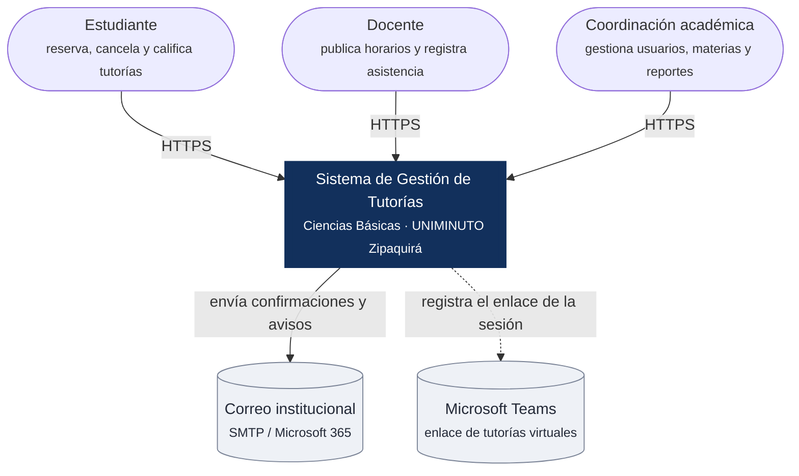
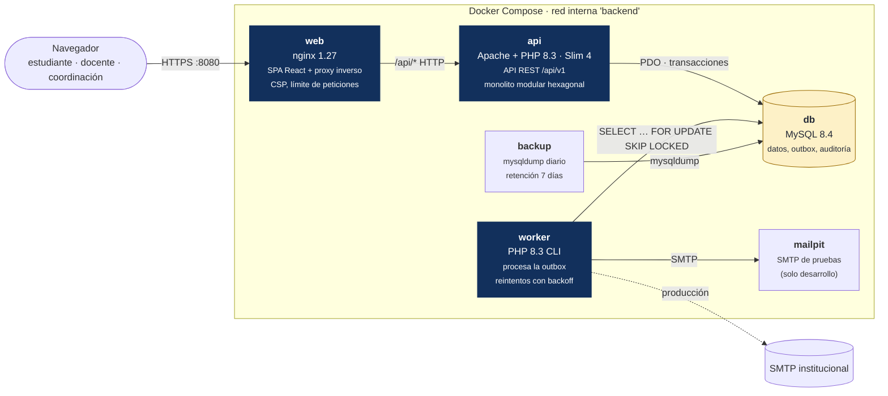
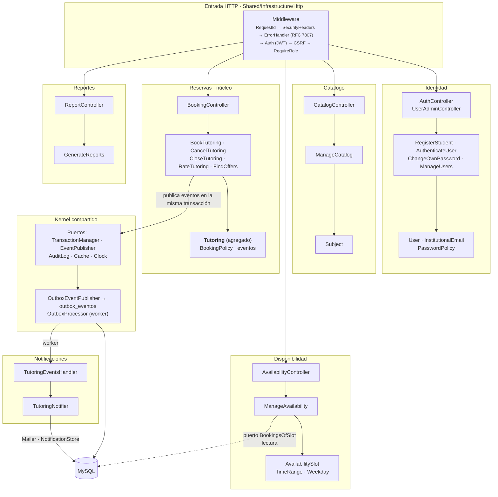

# 02 · Vistas C4

Los diagramas están en [Mermaid](https://mermaid.js.org/): GitHub y VS Code (extensión *Markdown Mermaid*) los dibujan directamente. Para Lucidchart (entregable T08–T11) basta con copiar la estructura.

## Nivel 1 · Contexto



## Nivel 2 · Contenedores



| Contenedor | Responsabilidad | Escala |
|---|---|---|
| `web` | Sirve la SPA compilada y reenvía `/api` a la API en el mismo origen (cookies `SameSite=Strict`) | Horizontal |
| `api` | Casos de uso síncronos; sin estado de sesión en memoria (JWT) | Horizontal (2 réplicas en producción) |
| `worker` | Efectos secundarios asíncronos (correo, notificaciones internas) | Horizontal: `SKIP LOCKED` evita procesar dos veces |
| `db` | Fuente única de verdad, consistencia transaccional | Vertical; réplica de lectura para Reportes si se requiere |
| `migrate` | Contenedor de una sola ejecución: aplica migraciones antes de iniciar la API | — |

## Nivel 3 · Componentes del backend

Cada módulo sigue la misma estructura hexagonal: **Domain** (entidades y reglas, sin dependencias), **Application** (casos de uso y puertos), **Infrastructure** (adaptadores PDO, SMTP…) y **Http** (controladores y rutas).



### Reglas de dependencia

1. **El dominio no depende de nada** externo: ni de PDO, ni de HTTP, ni de Slim. Por eso `TutoringTest` corre en milisegundos sin base de datos.
2. **Los módulos no importan clases de otros módulos.** Cuando Disponibilidad necesita saber si una franja tiene reservas, declara su propio puerto (`BookingsOfSlot`) y lo implementa con una consulta de lectura. Cuando necesita saber si el docente dicta la materia, usa `TeachingAssignments`. Así, extraer un módulo como servicio independiente solo exige cambiar el adaptador (ADR-0001).
3. **Solo `config/container.php` conoce las implementaciones concretas** (raíz de composición, ADR-0002).
4. **Lectura y escritura separadas (CQRS ligero):** los listados y reportes usan consultas optimizadas (`*Queries`) sin pasar por los agregados; las escrituras siempre pasan por el agregado que protege las reglas.

### Estructura de carpetas

```
backend/src/
├── Shared/          Kernel: errores de dominio, puertos, middleware, outbox, logging, seguridad
├── Identity/        Domain · Application · Infrastructure · Http
├── Catalog/         …
├── Scheduling/      …
├── Booking/         …  (núcleo: agregado Tutoring, control de concurrencia)
├── Notifications/   …
├── Reporting/       …
├── Platform/        Health checks, métricas, consola (seed, migración heredada)
└── Kernel.php       Arranque HTTP y registro de rutas por módulo
```
