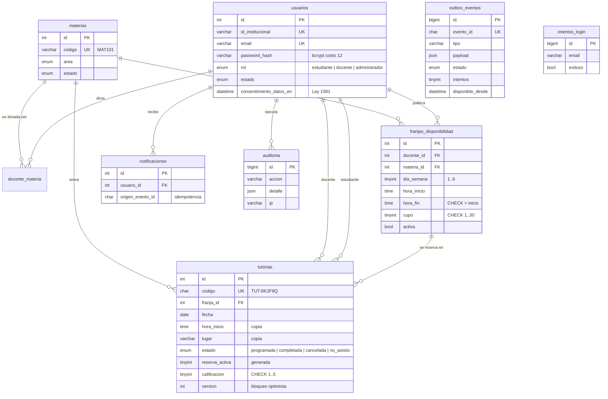

# 03 · Modelo de datos

## Decisiones de diseño

| Decisión | Motivo |
|---|---|
| **Copia de horario y lugar en `tutorias`** | Si el docente cambia el salón de su franja, el historial conserva dónde ocurrió realmente cada tutoría. |
| **`reserva_activa` = `IF(estado = 'programada', 1, NULL)` + índice único `(franja_id, fecha, estudiante_id, reserva_activa)`** | La BD impide dos reservas activas del mismo estudiante en la misma franja y fecha. Como `NULL` no colisiona en índices únicos, las canceladas no estorban para volver a reservar. |
| **`version` en `tutorias`** | Bloqueo optimista: si docente y estudiante modifican la misma tutoría a la vez, el segundo recibe `409` en vez de pisar el cambio. |
| **`CHECK` en horas, cupo y calificación** | Las invariantes se validan en el dominio y además en la BD (defensa en profundidad). |
| **Índices por consulta real** | `ix_franjas_busqueda (materia, docente, activa, día)` para la oferta; `ix_tutorias_cupo (franja, fecha, estado)` para contar cupos bajo bloqueo; `ix_tutorias_reportes (fecha, estado, materia)` para los reportes. |
| **`utf8mb4_unicode_ci`** | Tildes y ñ correctas en nombres, búsquedas sin distinguir mayúsculas. |
| **Las franjas se pausan, no se borran** | Las tutorías históricas siguen apuntando a su franja (`ON DELETE` restrictivo). |

## Migraciones

Las migraciones están en `backend/database/migrations/VNNN__descripcion.sql` y se aplican con `php bin/console migrate`. El migrador guarda un checksum de cada archivo: si alguien edita una migración ya aplicada, el comando falla y obliga a crear una nueva. Así todos los entornos (desarrollo, Staging, Producción) tienen exactamente el mismo esquema.

| Versión | Contenido |
|---|---|
| V001 | Esquema completo |
| V002 | Catálogo de 24 materias de Ciencias Básicas (tomado del sistema heredado) |

## Diferencias con el esquema heredado

| Heredado | Nuevo |
|---|---|
| `disponibilidad_docentes.estado` ('disponible'/'ocupado') sin cupo | `cupo` por franja, ocupación calculada desde las reservas |
| `cargar_semanas_disponibles.php` consultaba `max_estudiantes`, columna que **no existía** | Consulta de cupos única y probada (`PdoOfferQueries`) |
| La tutoría solo guardaba `disponibilidad_id`; editar la franja reescribía el historial | Copia del horario y lugar en la tutoría |
| Sin restricción contra doble reserva | Índice único + bloqueo de fila |
| `dia_semana` como texto con tilde ('Miércoles') | Entero ISO-8601 (1–6) |
| Contraseña en `password` | `password_hash` + política de contraseñas + rehash automático |
| Sin auditoría, sin notificaciones, sin outbox | Tablas dedicadas |
