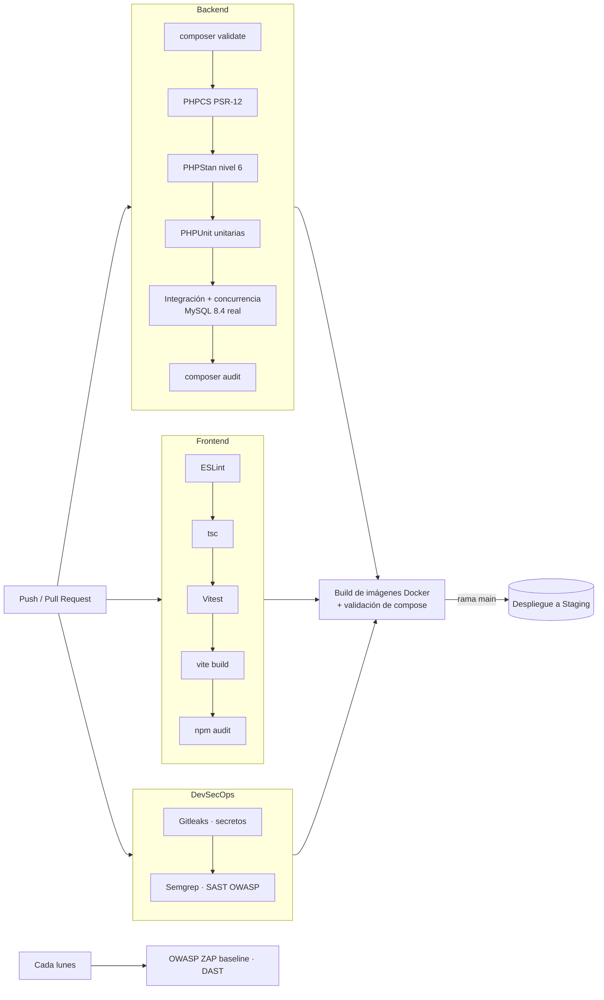

# 05 · Despliegue y operación

## Entornos (T17)

Los tres entornos se describen como código con Docker Compose y solo cambian por variables de entorno:

| Entorno | Cómo se levanta | Diferencias |
|---|---|---|
| **Desarrollo** | `docker compose up -d --build` o, sin Docker, `composer serve` + `npm run dev` | Mailpit captura los correos; datos de demostración; botones de cuentas demo en el login |
| **Staging** | `docker compose -f docker-compose.yml -f docker-compose.prod.yml up -d` en el servidor de pruebas | SMTP real de pruebas; datos migrados del sistema heredado (`legacy:import`) |
| **Producción** | Igual que Staging, con `.env` de producción | `COOKIE_SECURE=true`, HSTS, 2 réplicas de API y worker, sin datos demo |

## Pipeline CI/CD (T18, T19)



Archivos: `.github/workflows/ci.yml` y `.github/workflows/dast.yml`. La rama `main` se protege exigiendo que los cuatro jobs estén en verde y una revisión aprobada (plantilla en `.github/pull_request_template.md`).

## Observabilidad (T22)

| Señal | Dónde | Uso |
|---|---|---|
| **Liveness** `GET /health` | API (red interna) | Docker reinicia el contenedor si falla 3 veces |
| **Readiness** `GET /health/ready` | API | Verifica la BD (latencia) y la outbox (eventos atrasados > 10 min o fallidos) |
| **Métricas** `GET /metrics` | API (formato Prometheus) | `tutorias_total{estado}`, `outbox_eventos{estado}`, `usuarios_activos{rol}`, `login_fallidos_15m` |
| **Logs JSON** | stdout de cada contenedor | Una línea por petición con `method`, `path`, `status`, `duration_ms` y `request_id`; los errores incluyen el mismo `request_id` que recibe el usuario |
| **Auditoría** | Tabla `auditoria` y pantalla de coordinación | Quién hizo qué y desde qué IP |

Alertas sugeridas (Grafana/Prometheus): `outbox_eventos{estado="fallido"} > 0`, `login_fallidos_15m > 50`, p95 de `duration_ms` > 500 ms durante 5 min, `/health/ready` ≠ 200.

## Respaldos y recuperación (T21, T38)

- **Respaldo:** el servicio `backup` ejecuta `mysqldump --single-transaction` cada 24 h, comprime el archivo y conserva 7 días en el volumen `backups`.
- **RPO:** 24 horas (pérdida máxima de datos). Para reducirlo, activa los binlogs de MySQL y respalda los incrementales cada hora.
- **RTO:** 1 hora (tiempo máximo para restaurar).

Restaurar el último respaldo:

```bash
docker compose exec backup sh -c 'ls -1t /backups | head -1'
docker compose exec -T backup sh -c 'gunzip -c /backups/<archivo>.sql.gz' \
  | docker compose exec -T db mysql -u root -p"$MYSQL_ROOT_PASSWORD" tutorias
```

**Simulacro (criterio de T21):** restaurar el respaldo en una base vacía, ejecutar `php bin/console migrate` (no debe aplicar nada) y comprobar que `/health/ready` responde `200` y que los totales de `/metrics` coinciden con los de producción.

## Despliegue progresivo (T41)

1. **Blue-green con Compose:** se levanta la versión nueva con otro nombre de proyecto (`-p tutorias-green`) apuntando a la misma BD (las migraciones son aditivas).
2. Se verifica `/health/ready` y se ejecutan las pruebas de humo.
3. Se cambia el proxy de entrada al stack verde. **Rollback:** volver a apuntar al azul (segundos).
4. Las migraciones se diseñan *expand/contract*: primero se agregan columnas o tablas y en una versión posterior se eliminan las viejas. Así ambas versiones conviven durante el cambio.

## Runbook breve

| Síntoma | Diagnóstico | Acción |
|---|---|---|
| Los estudiantes no reciben correos | `/health/ready` → `outbox.fallidos > 0`; `docker compose logs worker` | Revisar las credenciales SMTP; corregir y ejecutar `UPDATE outbox_eventos SET estado='pendiente', intentos=0 WHERE estado='fallido'` |
| "Ocurrió un error inesperado" | El usuario reporta el `request_id` | `docker compose logs api \| grep <request_id>` |
| Un usuario quedó bloqueado por intentos | Tabla `intentos_login` | Esperar 15 minutos o borrar sus intentos fallidos recientes |
| Lentitud en el inicio de semestre | `duration_ms` alto en logs; `slow_query_log` de MySQL | Escalar `api` (`--scale api=3`); revisar consultas lentas |
